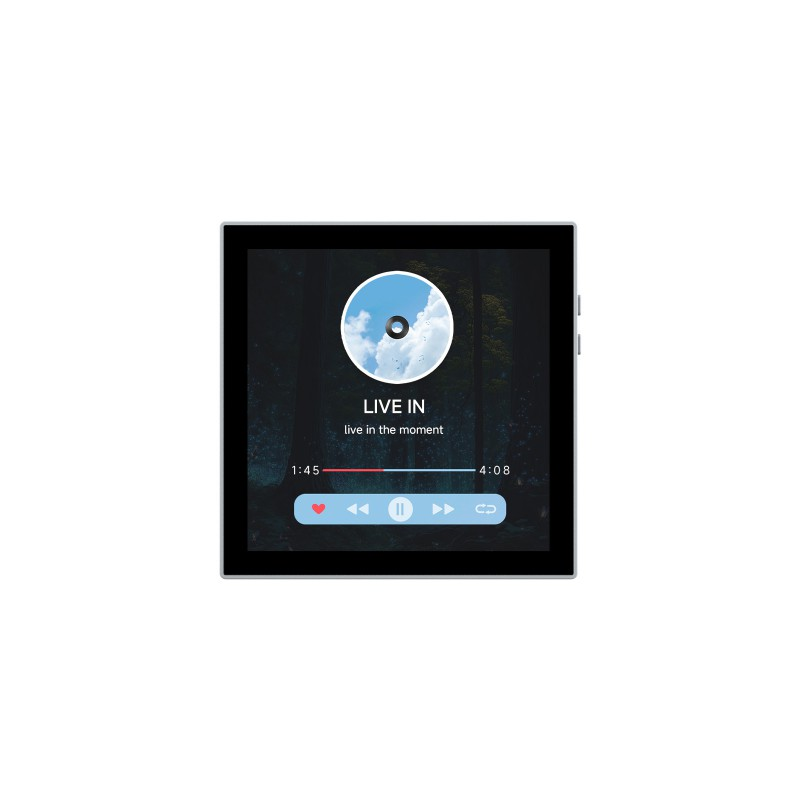

  <h1>ESP32-P4-WIFI6-Touch-LCD-4B</h1>
  
ESP32-P4 4-inch 720 × 720 MIPI-DSI touch development board.

  

    
    
    
  

  
<strong>English</strong> · <a href="README_ZH.md">简体中文</a>

  
<a href="https://www.waveshare.com/esp32-p4-wifi6-touch-lcd-4b.htm">🌐 Product</a> &middot; <a href="https://github.com/waveshareteam/ESP32-P4-WIFI6-Touch-LCD-4B/releases/latest">📦 Firmware</a> &middot; <a href="examples/esp-idf/">🧩 ESP-IDF</a> &middot; <a href="examples/arduino/examples/">🔧 Arduino</a> &middot; <a href="hardware/">📚 Documentation</a>

  

---

## ✨ Overview

This repository provides ESP-IDF and Arduino examples, factory firmware source, and hardware references for ESP32-P4-WIFI6-Touch-LCD-4B. The factory firmware supports the ST7703 and JD9365 display variants through one application image.

| Item | Specification |
| --- | --- |
| MCU | ESP32-P4 |
| Display | 4-inch 720 × 720 MIPI DSI touch display |
| Flash / PSRAM | 32 MB / 32 MB |
| Wireless | ESP32-C6 coprocessor |

## 📦 Quick Start

1. Download the tested combined factory firmware from [firmware](firmware/README.md).
2. Flash it with the command in that firmware entry.
3. The firmware reports its selected display controller on the serial console during boot.

## 🧪 Examples

**ESP-IDF (12 projects)**

| Example | Purpose |
| --- | --- |
| [project-template](examples/esp-idf/project-template/) | Minimal project structure |
| [hello_world](examples/esp-idf/hello_world/) | Minimal application and CI smoke test |
| [i2c-tools](examples/esp-idf/i2c-tools/) | Interactive I2C scanning and register access |
| [sd-card](examples/esp-idf/sd-card/) | MicroSD card access |
| [wifi-station](examples/esp-idf/wifi-station/) | Station-mode Wi-Fi through ESP32-C6 |
| [audio-codec](examples/esp-idf/audio-codec/) | ES8311 playback/audio path |
| [lcd-color-test](examples/esp-idf/lcd-color-test/) | Display color test |
| [display-panel](examples/esp-idf/display-panel/) | BSP-backed display/touch UI |
| [lvgl-v9](examples/esp-idf/lvgl-v9/) | LVGL 9 demonstration |
| [usb-extended-screen](examples/esp-idf/usb-extended-screen/) | USB display/audio/touch composition |
| [ethernet](examples/esp-idf/ethernet/) | IP101 Ethernet |
| [rs485](examples/esp-idf/rs485/) | UART/RS485 transmit and receive |

**Arduino (10 sketches)**

| Example | Purpose |
| --- | --- |
| [01_HelloWorld](examples/arduino/examples/01_HelloWorld/) | Minimal Arduino_GFX DSI display bring-up |
| [02_AsciiTable](examples/arduino/examples/02_AsciiTable/) | Arduino_GFX capability/benchmark table |
| [03_Drawing_board](examples/arduino/examples/03_Drawing_board/) | GT911 five-point capacitive touch drawing |
| [04_LVGLV9_Arduino](examples/arduino/examples/04_LVGLV9_Arduino/) | LVGL 9 widgets UI with touch input |
| [05_GFX_ESPWiFiAnalyzer](examples/arduino/examples/05_GFX_ESPWiFiAnalyzer/) | Graphical Wi-Fi scan (on-board ESP32-C6 coprocessor) |
| [06_Camera_Preview](examples/arduino/examples/06_Camera_Preview/) | OV5647 MIPI-CSI camera preview on the display |
| [07_Camera_ISP_Tuning](examples/arduino/examples/07_Camera_ISP_Tuning/) | Live preview with interactive ISP/3A tuning over serial |
| [08_SD_Card](examples/arduino/examples/08_SD_Card/) | microSD read/write over the SDIO 3.0 slot |
| [09_Audio_Playback](examples/arduino/examples/09_Audio_Playback/) | ES8311 codec plays the opening of "Für Elise" as different-frequency tones |
| [10_Mic_Record](examples/arduino/examples/10_Mic_Record/) | ES7210 quad-microphone capture; prints peak/RMS/decimated samples over serial |

The open factory project is in [examples/factory](examples/factory/README.md).

## 🛠️ Development Environment

| Framework | Version | Scope |
| --- | --- | --- |
| ESP-IDF | v5.5.6, v6.1 | First-party examples |
| Arduino-ESP32 | 3.3.12 | Arduino sketches |
| ESP-IDF | v5.5.6 | Factory firmware |

## 📚 Resources

- [Schematics](hardware/schematic/README.md)
- [Mechanical drawing](hardware/mechanical/ESP32-P4-WIFI6-Touch-LCD-4B-Dimensions.pdf)
- [Official product page](https://www.waveshare.com/esp32-p4-wifi6-touch-lcd-4b.htm)
- [Product documentation](https://docs.waveshare.com/ESP32-P4-WIFI6-Touch-LCD-4B)

## 🤝 Support

- [GitHub issues](https://github.com/waveshareteam/ESP32-P4-WIFI6-Touch-LCD-4B/issues)
- [Technical support](https://www.waveshare.com/contact_us)

## 📄 License

First-party software and project documentation use [Apache-2.0](LICENSE). Third-party materials retain their own terms; see [licensing boundaries](docs/licensing.md).
