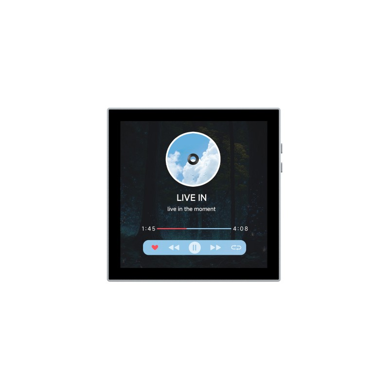

  <h1>ESP32-P4-WIFI6-Touch-LCD-4B</h1>
  
基于 ESP32-P4 的 4 英寸 720 × 720 MIPI-DSI 触摸开发板。

  

    
    
    
  

  
<a href="README.md">English</a> · <strong>简体中文</strong>

  
<a href="https://www.waveshare.com/esp32-p4-wifi6-touch-lcd-4b.htm">🌐 产品</a> &middot; <a href="https://github.com/waveshareteam/ESP32-P4-WIFI6-Touch-LCD-4B/releases/latest">📦 固件</a> &middot; <a href="examples/esp-idf/">🧩 ESP-IDF</a> &middot; <a href="examples/arduino/examples/">🔧 Arduino</a> &middot; <a href="hardware/">📚 文档</a>

  

---

## ✨ 概述

本仓库提供 ESP32-P4-WIFI6-Touch-LCD-4B 的 ESP-IDF 和 Arduino 示例、出厂固件源码及硬件资料。出厂固件使用同一应用镜像支持 ST7703 与 JD9365 两种显示屏。

| 项目 | 规格 |
| --- | --- |
| MCU | ESP32-P4 |
| 显示屏 | 4 英寸 720 × 720 MIPI DSI 触摸屏 |
| Flash / PSRAM | 32 MB / 32 MB |
| 无线 | ESP32-C6 协处理器 |

## 📦 快速开始

1. 从 [firmware](firmware/README_ZH.md) 下载经过实测的合并出厂固件。
2. 按该条目中的命令烧录。
3. 固件启动时会在串口输出所选的显示控制器。

## 🧪 示例

| 框架 | 示例 |
| --- | --- |
| ESP-IDF | [13 个工程](examples/esp-idf/README_ZH.md) |
| Arduino | [10 个草图](examples/arduino/README_ZH.md) |

开放的出厂工程位于 [examples/factory](examples/factory/README_ZH.md)。

## 🛠️ 开发环境

| 框架 | 版本 | 范围 |
| --- | --- | --- |
| ESP-IDF | v5.5.3、v5.5.6、v6.1 | 首方示例 |
| Arduino-ESP32 | 3.3.12 | Arduino 草图 |
| ESP-IDF | v5.5.6 | 出厂固件 |

## 📚 资料

- [原理图](hardware/schematic/README_ZH.md)
- [尺寸图](hardware/mechanical/ESP32-P4-WIFI6-Touch-LCD-4B-Dimensions.pdf)
- [产品页面](https://www.waveshare.com/esp32-p4-wifi6-touch-lcd-4b.htm)
- [产品文档](https://docs.waveshare.com/ESP32-P4-WIFI6-Touch-LCD-4B)

## 🤝 支持

- [GitHub issues](https://github.com/waveshareteam/ESP32-P4-WIFI6-Touch-LCD-4B/issues)
- [技术支持](https://www.waveshare.com/contact_us)

## 📄 许可证

第一方软件和项目文档采用 [Apache-2.0](LICENSE)。第三方材料保留各自条款，详见[许可边界](docs/licensing_ZH.md)。
